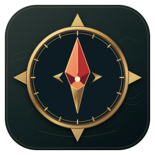
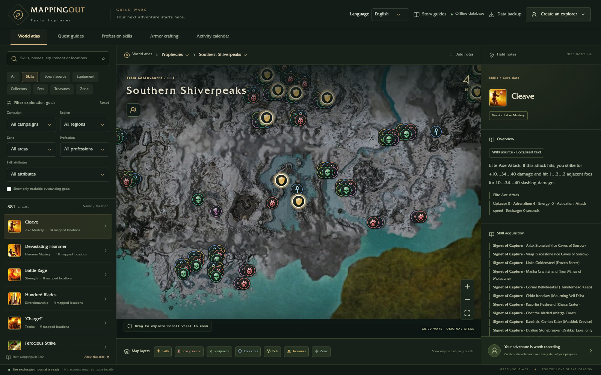
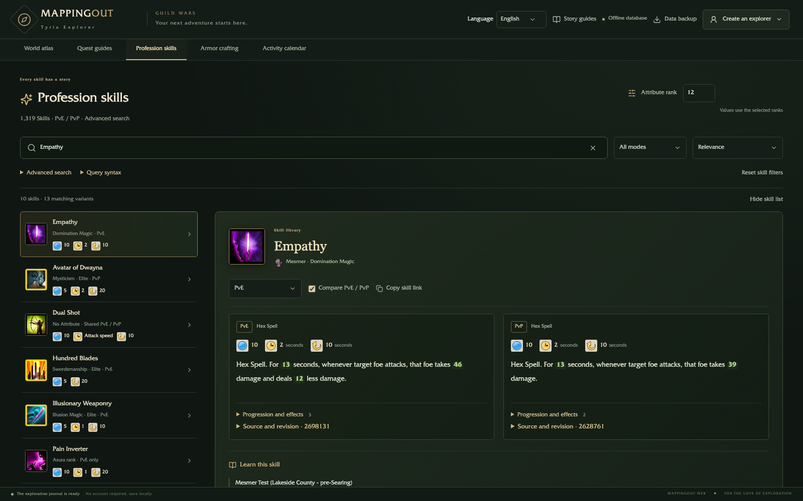
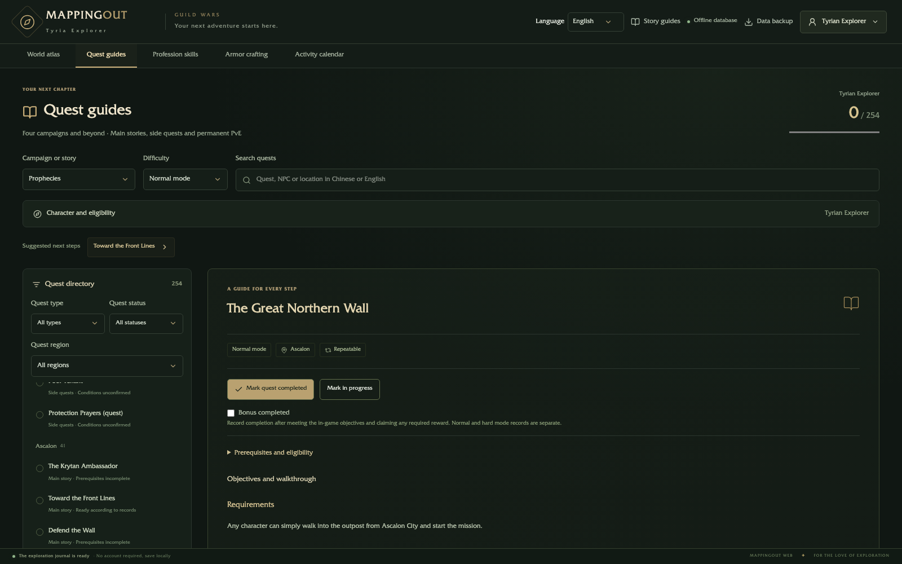

<p align="center">
  
</p>

<h1 align="center">MappingOut</h1>

<p align="center">
  An atlas and personal exploration journal for the original Guild Wars.
</p>

<p align="center">
  <a href="https://mappingout-web.zhubby.workers.dev">Open the web app</a> ·
  <a href="https://github.com/zhubby/mappingout/releases/latest">Download for Windows &amp; macOS</a> ·
  <a href="#deploy-to-cloudflare-workers">Deploy to Cloudflare</a> ·
  <a href="#deploy-with-docker">Deploy with Docker</a>
</p>

<p align="center">
  <a href="https://deploy.workers.cloudflare.com/?url=https://github.com/zhubby/mappingout">
    
  </a>
</p>

Explore Tyria, Cantha, Elona, and the Far North with maps, guides, and character progress.
Rebuilt from MappingOut 4.00, with English and Simplified Chinese interfaces.
Use it in your browser or as a Tauri desktop app. No account required.



## Features

- **World atlas** — Explore 20 maps with searchable skills, bosses, equipment, collectors, pets, and treasures.
- **Skill library** — Search 1,319 skills by profession, resources, and effects; compare PvE/PvP versions.
- **Quest guides** — Browse missions, prerequisites, rewards, and route maps; record progress for each character.
- **Armor workshop** — Compare armor, calculate materials and costs, and track crafting plans.
- **Activity calendar** — Follow Zaishen rotations, Nicholas the Traveler, and weekly bonuses across time zones.
- **Personal journal** — Save skill captures, vanquishes, treasure dates, and map notes locally.

| Skill search and PvE/PvP comparison | Quest guides and character progress |
| --- | --- |
| [](docs/images/readme-skills.png) | [](docs/images/readme-quests.png) |

## Offline use and backups

Open the web app online once to cache the application and reference data.
Visit each map online to cache its image before going offline.
Browser offline support requires HTTPS or localhost; browsers can reclaim cached files.
For desktop use, download or import the resource pack before going offline.

Character records stay in your browser's IndexedDB.
Export JSON backups to move between browsers, addresses, or desktop installs.
Different addresses keep separate records. Importing a backup replaces the destination's personal data after confirmation.

## Deploy to Cloudflare Workers

Click **Deploy to Cloudflare** above to launch the official setup flow.
Connect your Cloudflare and GitHub accounts, then choose your repository and Worker names.
Cloudflare copies this repository into your GitHub account, builds it, and deploys your own instance.
No database bindings or application secrets are required.

Use Node.js **24** and the repository root as the project directory.
Cloudflare detects the `build` and `deploy` scripts automatically; `.node-version` pins Node.js 24.
For subsequent Git builds, use these settings to avoid building twice:

| Setting | Value |
| --- | --- |
| Build command | `npm run build` |
| Deploy command | `npm run deploy:assets` |
| Root directory | Repository root |

To deploy from your terminal instead:

```sh
npm ci
npx wrangler login
npm run deploy
```

See the [deployment guide](docs/guides/cloudflare-workers.md) for caching, rollbacks, and backup migration.

## Deploy with Docker

Use Docker Engine with the Compose plugin to run the published Linux image on amd64 or arm64.
Download the deployment file into a new directory:

```sh
curl -fsSLO https://raw.githubusercontent.com/zhubby/mappingout/main/compose.yaml
MAPPINGOUT_IMAGE=ghcr.io/zhubby/mappingout:edge docker compose up -d --wait
```

Open `http://localhost:8080`. Use `edge` until the first container release is published;
Compose otherwise defaults to `ghcr.io/zhubby/mappingout:latest`.
Pin a published version or image digest for production.
Set `MAPPINGOUT_PORT` to change the host port.

The image serves the complete web build, including maps, reference data, fonts, licenses, and the offline service worker.
Personal records stay in each browser; no database or persistent container volume is required.
Serve the site at the domain root through an HTTPS reverse proxy for remote offline use.
Keep the same scheme, host, and port when updating to retain access to browser records.

See the [container guide](docs/guides/container-deployment.md) for local builds, updates, rollbacks, and GHCR publishing.

## Local development

Install Node.js **24 or later**, then run:

```sh
npm ci
npm run dev
```

Open the local URL printed by Vite, usually `http://127.0.0.1:5173`.
On Windows, use `npm.cmd` if PowerShell blocks `npm.ps1`.

Validate the production build and Worker configuration without publishing:

```sh
npm run check:worker
```

Built assets go into `dist/`. Preview them with `npm run preview:worker` at `http://127.0.0.1:8787`.
The repository includes generated data and images; building requires no original MappingOut installation.

Run unit tests with `npm test`. After building, run Worker browser tests with `npm run test:e2e:worker`.
Browser tests use Microsoft Edge through Playwright; see the [test guide](docs/guides/cloudflare-workers.md#验收).

Built with React 19, TypeScript, Vite, Leaflet, Tailwind CSS, and Tauri 2.

## Documentation and credits

Detailed guides are currently in Chinese:
[project structure](docs/guides/project-structure.md) · [container deployment](docs/guides/container-deployment.md) · [desktop app](docs/guides/desktop.md) · [offline resources](docs/guides/desktop-resources.md) ·
[quest guides](docs/guides/quest-guides.md) · [skill library](docs/guides/skills.md) ·
[armor and calendar](docs/guides/armor-calendar.md) · [languages and fonts](docs/guides/i18n.md).

Game artwork and text belong to their respective rights holders.
Wiki revisions and known data gaps remain documented in the [source review](docs/guides/wiki-data-review.md).
Machine-assisted translations remain marked for review; local license and font notices accompany the assets.
