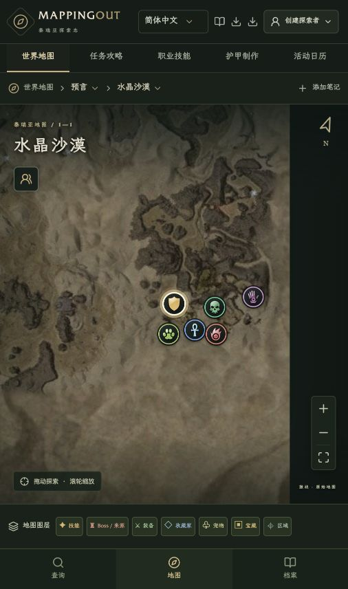
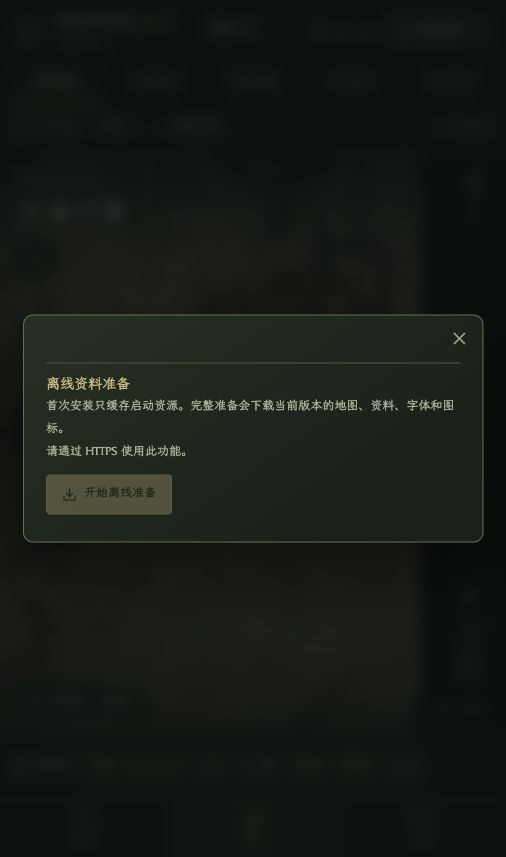

# 1.3.2 发布与 ZimaBoard2 验收

验证日期：2026-11-19，UTC+08:00。
程序源码：`a6c1ae8547b429bae3356f5882a0b2a411862886`。
性能提交：`053b5db`。
发布标签：`desktop-v1.3.2`。

## 本地验证

性能实施及离线回归见 [性能验收](performance-optimization.md)。
本版重新执行发布门槛、300 项单测和生产构建，全部通过。
本地生产构建的 Web 回归 53 项通过。
范围为地图、功能页、双语、菜单、任务与技能。
桌面更新前端回归 11 项通过。
首次预缓存约 730 KiB；全量离线约 161 MiB。
全量离线由用户手动启动。原字体在空闲时加载。

## 发布流水线

[正式容器流水线](https://github.com/zhubby/mappingout/actions/runs/44467627706) 全部成功。
两个原生 runner 的镜像构建、单测及 HTTP 验收通过。
amd64 最终镜像的浏览器验收通过。
该流水线执行 app、features 和 container 测试集。
任务和完整离线流程另见本地性能验收。
[main 容器流水线](https://github.com/zhubby/mappingout/actions/runs/44467567645) 全部成功。

[桌面流水线](https://github.com/zhubby/mappingout/actions/runs/44467627746) 全部成功。
Windows x64、Windows x86、macOS arm64 均完成构建与原生测试。
聚合任务公开发布安装包、更新清单与资源清单。

## 公开产物回读

[GitHub Release](https://github.com/zhubby/mappingout/releases/tag/desktop-v1.3.2)
于 `2026-11-19T06:03:41Z` 公开发布。
Release 不是草稿或预发布版。
匿名读取的 `latest.json` 版本为 `1.3.2`。
三平台更新地址均指向本版附件，匿名请求返回 HTTP 200。
全部 10 个附件的 SHA-256 符合 GitHub API 摘要。
`SHA256SUMS.txt` 的四项程序包校验全部通过。
原程序更新公钥验证三份更新包签名通过。
签名可信注释均绑定 `1.3.2`。
独立 `.sig` 与更新清单中的签名一致。

`ghcr.io/zhubby/mappingout:1.3.2` 与 `latest` 指向同一 OCI 索引：
`sha256:1068cee46da916edde573ce41c790c71af1fdd847eee2f8366be4b6f80160102`。

| 架构 | 子清单摘要 |
| --- | --- |
| linux/amd64 | `sha256:de7739c08ff35be4807e7fe25fb56d01f75c8f029a694c93cf87c5f680164a8c` |
| linux/arm64 | `sha256:0c9d44c401d523a9465548d4dd6d0a2eeba5e407f19d2e383a001d9049a852b0` |

## ZimaBoard2 更新

通过 ZimaOS 原自定义应用的 YAML 入口更新。
镜像改为 `ghcr.io/zhubby/mappingout:1.3.2`。
Compose 项目保持 `custom__7ulpmykp`。
访问地址保持 <http://192.168.11.35:18881/>。
端口保持 `18881:8080/tcp`。
只读根文件系统、tmpfs 和安全选项保持。
个人记录继续位于浏览器 IndexedDB，无服务端数据卷。

实机运行 `scripts/container/smoke.mjs` 的 HTTP 验收通过。
线上 HTML、入口 JS/CSS 与两种图标和本地构建逐字节一致。
浏览器重新加载后，实际入口为 `index-UWW9NOft.js`。
新版离线准备入口显示 HTTPS 要求，开始按钮禁用。
升级前创建的“发布验收 1.3.2”角色在新版继续显示。
该角色的“维祖纳广场”任务仍为进行中。

Portainer 只读核对实际运行容器：

| 检查 | 实机结果 |
| --- | --- |
| 容器 ID | `5db8e6fc821d68cc5670a84cdb9c5d7495a10c36a4ffabbd88f726cffd4d4302` |
| 状态 | `running`、`healthy`，健康失败数为 0 |
| 重启与 OOM | `RestartCount=0`，`OOMKilled=false` |
| 镜像 ID | `sha256:47c79d21eea346c2fc16e58d03e80c114a25876688ecd253c8bcf0d88a0779ac` |
| OCI 版本 | `1.3.2` |
| OCI revision | `a6c1ae8547b429bae3356f5882a0b2a411862886` |
| 运行用户 | `101:101` |
| 文件系统 | 只读根目录；`/tmp` 为 64 MiB tmpfs；无数据卷 |
| 权限 | `cap_drop=ALL`、`no-new-privileges:true` |
| 重启策略 | `unless-stopped` |

公开 GHCR 的 amd64 子清单 config.digest 与实机镜像 ID 一致。
最近 100 行访问日志未见 Nginx 错误或 HTTP 5xx。
该日志窗口不代表整个运行期间没有错误。

新版交互使用线上 `index-UWW9NOft.js` 复验：

| 功能 | 结果 |
| --- | --- |
| 地图 | 水晶沙漠加载；技能标记打开详情；发现地点定位回地图 |
| 任务 | 深链打开维祖纳广场；搜索缩为一项；升级前角色与进行中状态保留 |
| 技能 | 1,319 项加载；搜索 Healing Signet；等级 0 显示 82 点治疗；中英文切换成功 |
| 护甲 | 战士远古默认五件 50 白金、铁锭 400、皮革 40；取消头部后四件 40 白金、铁锭 350、皮革 35；恢复选择 |
| 日历 | 当前七项活动加载；月份从 2026 年 11 月切至 12 月 |
| 离线准备 | HTTP 页面显示 HTTPS 要求；开始按钮禁用 |

本轮截图为新版页面，旧入口截图不纳入本版证据。

回滚目标为 `ghcr.io/zhubby/mappingout:sha-b2675efc78a28c85e64cea3e1939ac3b7dca8afa`。
更新前完整 YAML 已保存到任务私有临时文件。
回滚沿用 ZimaOS，并保持端口和浏览器 origin。

## 资料与验证边界

资料、基线、审校记录和字体输入未改。
仅新增性能与离线准备界面的双语文本。
本版输入指纹为 `1055a01c4a3211c7b1c2c7a90379607a05d1da5dc2a04bcf16c58441d04dc3ae`。
重新评估的发布例外只绑定本版及原有五类问题。
人工审校与 Friz 字体许可状态未改变。
完整说明见 [发布说明](../releases/desktop-release-notes.md)。

局域网 HTTP 不支持远程 Service Worker 离线缓存。
完整离线回归使用本机安全上下文，未配置设备 HTTPS。
首次 catalog 与 skills 加载曾长时间停留在校验阶段，最终成功。
本次未取得可靠时序证据，未量化实机首屏改善。
未完成弱网、持续内存或并发访问压力测试。
三平台 CI 与签名回读不代替安装包实际安装验收。
本次未安装桌面程序或变更 Cloudflare 生产站点。

[PROTOCOL]: Update this header on change, then check AGENTS.md
