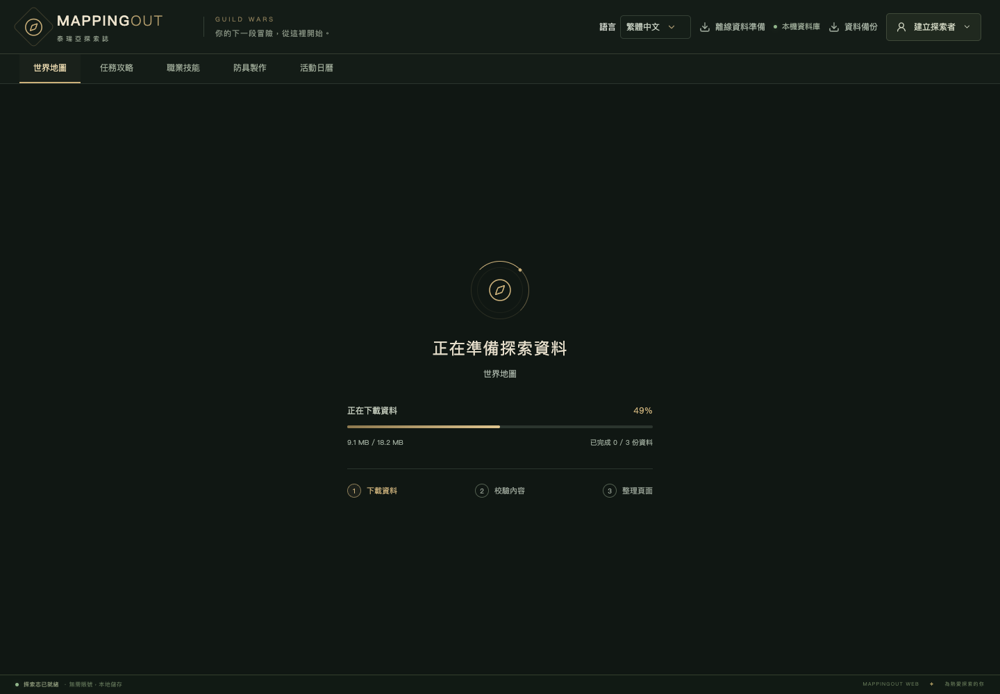
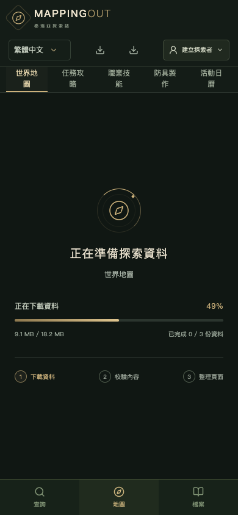
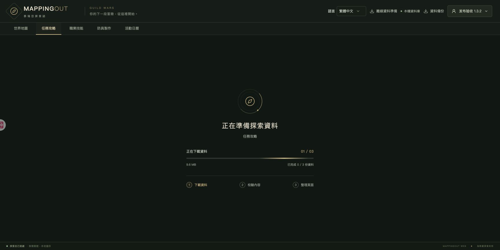
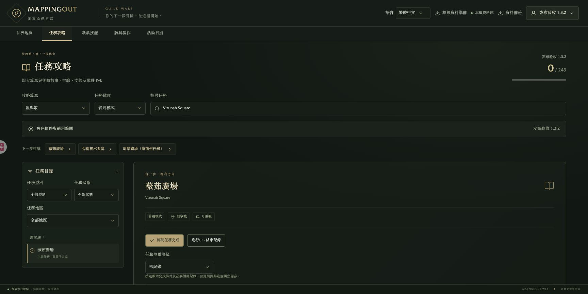

# 1.4.2 发布与 ZimaBoard2 验收

验证日期：2026-11-20，UTC+08:00。
发布源码：`f69e2e7fd6241330ac2b21f8319f18ab49d2c666`。
界面提交：`dbc4e1a84b163aae5a7c60e8b2257ddadf9fa5d1`。
发布标签：`desktop-v1.4.2`。

## 实作与本地验证

资料等待界面使用深绿和金色主题。
指南针动效、进度条与三步阶段共用一个组件。
下载量合并五套资料各自的三个并行请求。
已完成数只计算已读完的文件。
只有总量可靠时显示下载百分比。
压缩响应和未知长度使用流动进度条。
校验与整理阶段保持独立状态。
错误界面保留错误说明与重试入口。
功能懒加载也复用该组件。

- 1.4.2 生产构建通过。
- 1.4.2 全量单元测试 325 项通过。
- 1.4.2 发布门禁通过，完整性错误为 0。
- 初始候选版全量生产 Web 回归 60 项通过。
- 其中 5 项加载验收使用真实可暂停 HTTP 字节流。
- 这些验收覆盖繁英、手机、未知总量与失败重试。
- 减弱动效偏好停止动画，390px 页面无横向溢出。

1.4.2 相对初始候选版只改测试等待上限和版本说明。
全语料校验在共享 Linux runner 耗时超过 20 秒。
Windows x86 同项耗时 26.5 秒。
本版将这项测试上限改为 60 秒，保留所有断言。
`desktop-v1.4.1` 标签保持原样，候选版未公开发布。
该候选版剩余流水线已停止。

## 正式流水线

- [桌面发布](https://github.com/zhubby/mappingout/actions/runs/44671712114)全部通过。
- Windows x64、Windows x86、macOS arm64 构建与原生测试通过。
- [正式容器发布](https://github.com/zhubby/mappingout/actions/runs/44671712097)全部通过。
- amd64、arm64 最终镜像 HTTP 验收通过。
- amd64 最终镜像浏览器验收通过。
- [main 容器流水线](https://github.com/zhubby/mappingout/actions/runs/44671712539)全部通过。

[1.4.2 正式版](https://github.com/zhubby/mappingout/releases/tag/desktop-v1.4.2)
于 2026-11-20 12:17:10（UTC+08:00）公开。
本次没有执行桌面系统上的安装包安装。

## 公开产物回读

所有回读使用匿名公开下载地址。
10 个发布文件的大小与 GitHub SHA-256 元数据一致。
安装包与更新包也符合 `SHA256SUMS.txt`。
公开 latest 端点与本版 `latest.json` 完全一致。
Windows x64、Windows x86 和 macOS arm64 的更新签名通过。
三份签名的可信注释版本均为 `1.4.2`。
更新清单中的签名与公开 `.sig` 文件一致。
程序更新公钥保持原值。

资源清单和资源频道通过独立公钥验签。
media、data、fonts 三个 ZIP 的大小与哈希一致。
ZIP 内 3,710 个文件的大小和哈希全部一致。
资源代次仍为
`0ede4b4281935491bdf3e6171177aaa8334df499c9343b3481d48e022d9bc57c`。
公开频道包含该代次。

| 资源包 | 文件数 | SHA-256 |
| --- | ---: | --- |
| media | 3,680 | `538a0c5ef12b1db536a2da410976864339a1dd1808e85dcf4d2b0ac723838b26` |
| data | 22 | `c66d24a78238d215171003c97efe00e0f4d7166808bfbd7a15f432a0209e1985` |
| fonts | 8 | `1a18e395a4ba6a6b939d992d896fa7067f9c82edadfc19389743678890c381ee` |

GHCR `1.4.2` 与 `latest` 指向同一 OCI 索引。
索引摘要为
`sha256:b1e012ed396ddfa6b719b26321834f751bff8e9e68fbdee731d5c65dd6028425`。
版本标注为 `1.4.2`，源码标注与发布提交一致。
索引仅包含 Linux amd64 与 arm64。
两个子清单摘要与索引记录一致。

| 架构 | 清单摘要 | 镜像配置摘要 |
| --- | --- | --- |
| amd64 | `sha256:23d8dcd3d78b1ca86a974d09dca907ab7d27229c2908dd0145e76b056db8a645` | `sha256:353a9856afdcaa78b73d34076ad7460186ef1c3f31bcbc65c54043db42848ef4` |
| arm64 | `sha256:4d02a51c9ffe839a7a51bff6e9d9a09fab363d3fc87e4954bf48bdfb533164fe` | `sha256:d069fc0737e0f95f98b80c9e1d695648aaeb212c30084bc66f7c4e23409cfcc7` |

完整匿名回读结果保存在
`releases/verification-1.4.2/verification.json`。
下载副本与核验脚本保存在同一忽略目录。

## ZimaBoard2 实机部署

沿用 ZimaOS 的现有 MappingOut 应用。
仅将镜像 `1.4.0` 改为 `1.4.2`。
端口保持 `18881:8080`，无持久化卷。
只读文件系统、tmpfs 与原安全配置保持原值。
原 YAML 保存在 `releases/verification-1.4.2/zima-before.yaml`。
该目录被 Git 忽略，备份文件权限为 `600`。

- 入口：<http://192.168.11.35:18881/>。
- Dozzle 显示新容器 `dd465619f5ae`。
- 实际镜像为 `ghcr.io/zhubby/mappingout:1.4.2`。
- 容器产生新版脚本和资料的 HTTP 200 访问日志。
- `scripts/container/smoke.mjs` 对实机验收通过。
- `/healthz`、压缩、缓存、MIME、Range 与真实 404 通过。
- HTML、入口 JS 与 CSS 的 SHA-256 与本地构建一致。
- 页面加载脚本为 `/build/index-CjPH3WNc.js`。
- 任务攻略、职业技能、活动日历和世界地图均实际打开。
- 浏览器错误日志为空。
- 旧角色「发布验收 1.3.2」及薇茹廣場进行中记录保留。

实拍加载过程使用真实 HTTP 下载。
截图时临时限制网络速度，随后恢复默认速度与缓存。
压缩响应没有可靠总量，界面显示字节量与流动进度条。
本次读取了 HTTP 健康探针，未读取 Docker HEALTHCHECK 状态。

回滚入口仍为 ZimaOS → MappingOut → 管理 → YAML。
恢复备份 YAML 或将镜像改回 `1.4.0`，再保存并验收。
个人记录仍保存在同一浏览器 origin 的 IndexedDB。
本次未清理或重建个人记录。

## 资料和许可边界

游戏资料、译文、基线、审校记录与字体输入未改。
新增内容只有加载界面的繁英词条。
发布输入指纹：
`bc0a866c2357c44c950230c4710d0350da33e422df6a717d990642b32ce3c885`。
本版例外只接受原有五类待审项。
人工翻译复核和 Friz 分发授权仍待完成。
来源、哈希、字段与资源完整性门禁继续执行。

[PROTOCOL]: Update this header on change, then check AGENTS.md
