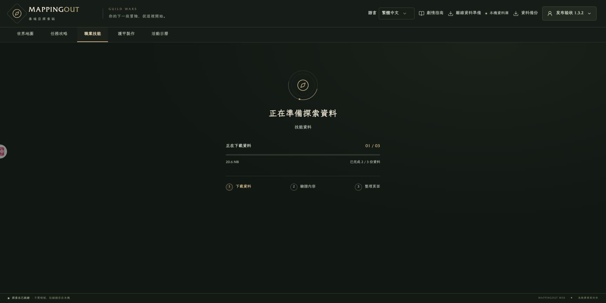
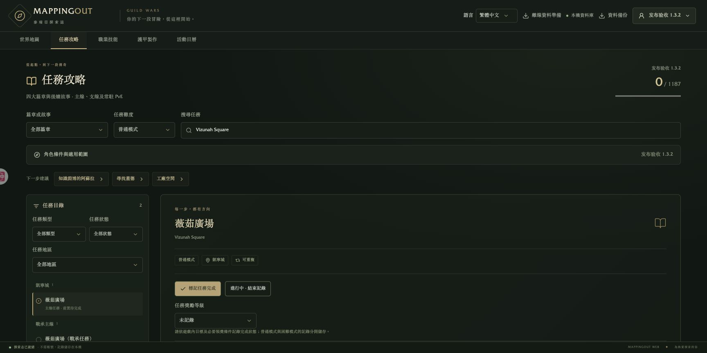

# 1.4.3 发布验收

日期：2026-11-23。
发布目标：desktop-v1.4.3。
发布源码：`3d25dc262084094d3db9afed159c96445cf986f0`。
本版为阶段性交付，全文逐句校对未完成。

## 本地实现与验证

本版校对范围见 [全文校对记录](full-text-proofreading.md)。
生产 Web 构建、资料与语言完整性检查通过。
全量单元测试 24 个文件、346 项通过。
生产 Web 浏览器回归 60 项全部通过。
覆盖繁英、手机、加载、离线、备份与角色隔离。
桌面更新界面 11 项回归通过。
更新界面使用真实组件与测试 IPC。
本轮未在桌面系统安装正式安装包。
在线复核 6,895 个英文引用，差异和错误均为零。
动态说明已审 420 个版本通过真实组件呈现检查。
错误动态效果身份的内存复现被两处完整性检查拒绝。

发布输入指纹：
`9d7b23d50184f134005f2a9df754a99d4d046e45cde0ff682ecd64ff13db33a6`。
正式门禁完整性错误为零。
版本例外只接受当前五类审校与许可问题。
人工批准和 Friz 授权仍待完成。

更新前 ZimaOS YAML 已保存到忽略目录
`releases/verification-1.4.3/zima-before.yaml`，权限为 600。
当前回滚版本为 1.4.2。

## 正式流水线

[桌面正式流水线](https://github.com/zhubby/mappingout/actions/runs/45112763276)
全部通过。
Windows x64、Windows x86、macOS arm64
签名构建与原生测试全部通过。
各平台均通过 346 项单元测试与 25 项原生测试。
[main 容器流水线](https://github.com/zhubby/mappingout/actions/runs/45112747993)
全部通过。
[正式容器流水线](https://github.com/zhubby/mappingout/actions/runs/45112763215)
全部通过。
amd64、arm64 最终镜像的 HTTP 验收通过。
amd64 最终镜像的浏览器验收通过。
两个架构各通过 346 项单元测试。
amd64 最终镜像通过 28 项浏览器验收。
已验收的镜像原样上传并合并双架构索引。

[1.4.3 正式版](https://github.com/zhubby/mappingout/releases/tag/desktop-v1.4.3)
于 2026-11-23 04:47:32 UTC 公开。

## 公开产物回读

10 个公开发布文件的大小与 GitHub SHA-256 一致。
安装包和更新包也符合 `SHA256SUMS.txt`。
三平台更新签名与可信版本注释通过。
公开 latest 端点与本版 `latest.json` 一致。
程序更新公钥保持原值。

资源清单与资源频道通过独立公钥验签。
media、data、fonts 三个 ZIP 的哈希全部一致。
ZIP 内 3,713 个文件逐个通过大小与哈希检查。
资源代次为：
`053d139d834451bd83f03bb1a3aae12bcb1d960561d84d974930833c31e9b157`。

| 资源包 | 文件数 | SHA-256 |
| --- | ---: | --- |
| media | 3,683 | `94ef222a5fe49e234c955ad9196ab397bfec4f7668ca4b4e0ccd13193f962249` |
| data | 22 | `9544d3981555ce35996e748edcbb3b939f38e695df4aedd89326c7b9f2f55c53` |
| fonts | 8 | `1a18e395a4ba6a6b939d992d896fa7067f9c82edadfc19389743678890c381ee` |

匿名 GHCR `1.4.3` 与 `latest` 指向同一索引。
版本和源码标注与发布标签一致。
索引只包含 Linux amd64 与 arm64。
索引摘要为：
`sha256:9a110af359080b7b8add779ee2c41745ef8d5835d1420c6f2db0d0e3ce43bf33`。

| 架构 | 清单摘要 | 镜像配置摘要 |
| --- | --- | --- |
| amd64 | `sha256:b93169b0d40f034697eeea620ec5639747cb96244ce5ba88235199b48048efe2` | `sha256:27902e80d8ee33a1fb0ce04d29a680f12b51bd7a943e6b5642aa0f24eb312c3f` |
| arm64 | `sha256:18d0ff8f9d1fa882cd7ebd2df75656b01ed089032f6035390004db777b92ed29` | `sha256:8fad5c51d112e37efeb387c1102688cc7fcdfa8b78cd9c0af66e7e60e6efd9f5` |

完整匿名回读结果位于忽略目录：
`releases/verification-1.4.3/verification.json`。

## ZimaBoard2 实机部署

沿用 ZimaOS → MappingOut → 管理 → YAML。
镜像从 `1.4.2` 更新为 `1.4.3`。
保存后重新打开配置，回读版本与全部参数。
端口保持 `18881:8080`，无持久化卷。
bridge 网络、只读文件系统、tmpfs 保持原值。
`cap_drop: ALL` 与 `no-new-privileges` 保持原值。
镜像经 ZimaOS 加速源拉取，约 19 分钟完成。

- 入口：[MappingOut](http://192.168.11.35:18881/)。
- Dozzle 显示新容器 `f5ed5f0007ab`。
- 实际镜像为 `ghcr.io/zhubby/mappingout:1.4.3`。
- 当前访问日志显示新版脚本与资料请求成功。
- 浏览器捕获的错误日志为空。
- 世界地图、任务攻略、职业技能、活动日历均实际打开。
- 地图图片与职业标记正常显示。
- 繁英界面切换成功，最后恢复繁体中文。
- Cleave 等级 12 正文显示 `+34`、`2`、`34`。
- 第二处伤害数值没有错误的加号。
- 旧角色「发布验收 1.3.2」保留。
- 薇茹廣場的「進行中 · 結束記錄」保留。

真实 HTTP 下载显示字节量与三步加载进度。
截图记录了 20.6 MB、已完成 2 / 3 份资料。
该压缩响应不显示无法可靠计算的百分比。

`scripts/container/smoke.mjs` 对实机验收通过。
覆盖健康探针、资料、字体、MIME 与缓存策略。
gzip、条件请求、Range 与真实 404 均通过。
前两轮在资料下载期间超过单请求 15 秒预算。
定位到 catalog 响应正文传输超时。
等待浏览器资料下载完成后，原样第三轮通过。
本次未调整超时预算或验收断言。
本次验证 HTTP 健康探针，未读取 Docker 健康状态。

HTML、入口 JS 与 CSS 的哈希符合本地构建。

| 实机文件 | 字节数 | SHA-256 |
| --- | ---: | --- |
| `/` | 1,056 | `728db89a364db1a67cf53784d8310bbefab5a1cf02f2045127012baa77ad2254` |
| `/build/index-80X1Angz.js` | 598,182 | `09d887cb101095eafa95e3952b8dcc6d494f9445b68390668ddbca9a81f0ed02` |
| `/build/index-CMQ0zFpg.css` | 74,219 | `3f0bb30578b4f9169f6010716db1436a63045f05c44c0e6150ae181a05c15483` |

哈希回读结果位于忽略目录：
`releases/verification-1.4.3/zima-http-hashes.json`。

回滚仍从 ZimaOS 的 YAML 入口执行。
恢复备份或将镜像改回 `1.4.2`，再保存并验收。
个人记录保存在原 origin 的 IndexedDB。
本次未清理或重建个人记录。

[PROTOCOL]: Update this header on change, then check AGENTS.md
