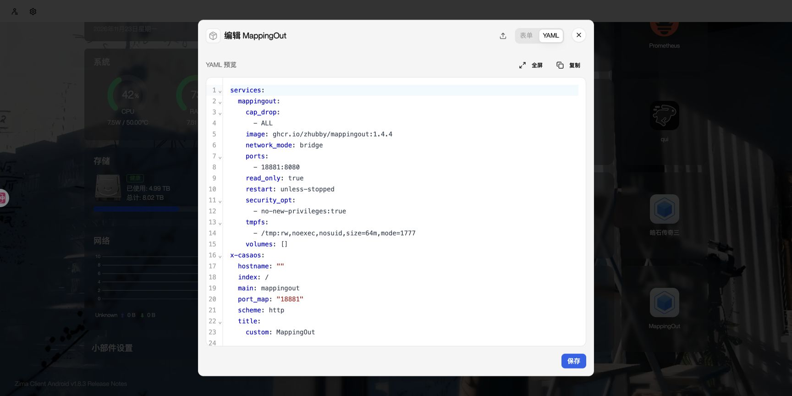
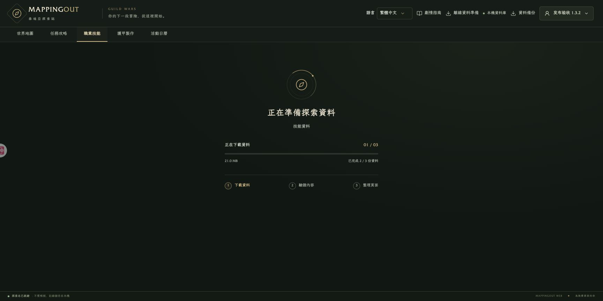
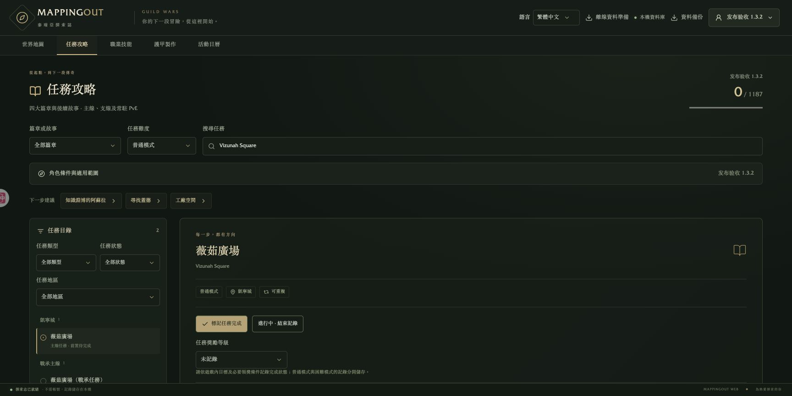
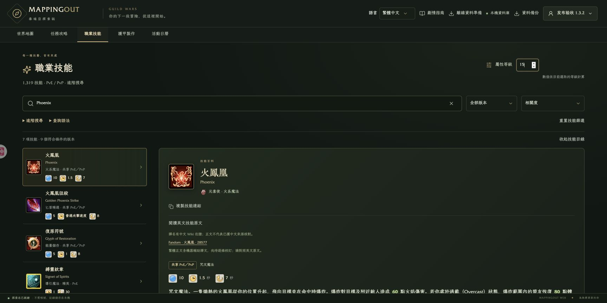

# 1.4.4 发布验收

日期：2026-11-23。
发布目标：desktop-v1.4.4。
发布源码：`e917a611ec281c5f41ee0bda1c1474fd5cac0a6c`。
本版为阶段性交付，全文逐句校对未完成。

## 校对范围与本地验证

本批新增 6,953 个精确字段绑定。
五套资料实际修订 2,284 个字段。
累计代理审读 9,296 个字段位置。
仍有 124,833 个字段位置未逐句审读。
详见 [全文校对记录](full-text-proofreading.md)。

1.4.4 生产构建通过。
全量单元测试 24 个文件、346 项通过。
同批资料的生产 Web 浏览器回归 60 项通过。
110 段技能正文覆盖 113 个版本。
真实组件繁英呈现 1,356 次，错误为零。
覆盖属性 0、12、15 与称号最低、最高边界。
核对 1,968 处数值和 72 处重复词元。
动态验收结果绑定四份输入的 SHA-256。

发布输入指纹：
`32b0061b127c6cee56105c3a4c3cc20e5245e3e0eee075874db8e4dbf1987558`。
正式门禁完整性错误为零。
新版本例外只接受当前五类审校与许可问题。
人工批准和 Friz 分发授权仍待完成。
护甲英文 64 种文本、76 个字段的标记残留尚未修复。

## 正式流水线

[桌面正式流水线](https://github.com/zhubby/mappingout/actions/runs/45119547205)
全部通过。
Windows x86、x64、macOS arm64 签名构建全部成功。
各平台通过 346 项单元测试与 25 项原生测试。
资源签名、发布与三平台更新清单合并成功。
本轮未在桌面系统安装正式安装包。

[main 容器流水线](https://github.com/zhubby/mappingout/actions/runs/45119525738)
与 [正式容器流水线](https://github.com/zhubby/mappingout/actions/runs/45119547256)
全部通过。
两个架构各通过 346 项单元测试与最终镜像 HTTP 验收。
amd64 最终镜像通过 28 项浏览器回归。
已验收镜像原样上传并合并双架构索引。

[1.4.4 正式版](https://github.com/zhubby/mappingout/releases/tag/desktop-v1.4.4)
于 2026-11-23 05:58:22 UTC 公开。

## 公开产物回读

10 个公开发布文件的大小与 GitHub SHA-256 一致。
安装包和更新包符合 `SHA256SUMS.txt`。
三平台更新签名与可信版本注释通过。
公开 latest 端点与本版 `latest.json` 一致。
程序更新公钥保持原值。

资源清单与资源频道通过独立公钥验签。
三个资源 ZIP 的哈希全部一致。
ZIP 内 3,713 个文件逐个通过大小与哈希检查。
资源代次为：
`fdc56ec8f92fd727dded67056d3ae7d9432930dac2e9ca407922009cd929f250`。

| 资源包 | 文件数 | SHA-256 |
| --- | ---: | --- |
| media | 3,683 | `94ef222a5fe49e234c955ad9196ab397bfec4f7668ca4b4e0ccd13193f962249` |
| data | 22 | `2f78f93f6b1c119f43df545e96a88b0aae5affdb188ef5ba4b99cec93cddd0df` |
| fonts | 8 | `1a18e395a4ba6a6b939d992d896fa7067f9c82edadfc19389743678890c381ee` |

匿名 GHCR `1.4.4` 与 `latest` 指向同一索引。
版本和源码标注与发布标签一致。
索引只包含 Linux amd64 与 arm64。
索引摘要为：
`sha256:8bd4296a4da3236edc36fd86a44071931e960b79d61e3f32ddc78fac30b6ab67`。

| 架构 | 清单摘要 | 镜像配置摘要 |
| --- | --- | --- |
| amd64 | `sha256:a2ac130a0c7c605c5714ce925fa395b2f99a20b449a7cbcb57fbe4953a545392` | `sha256:44e656448acae51464dcd4c7cb046735db6616f7a3f6d723e954081942353490` |
| arm64 | `sha256:d974bf2d485681d3b63fbf090d156881022d24d37ebe1efbd0e7ecfd1126704c` | `sha256:254543dfa7eb88d647de7b468b31f71aaef9ce20db26bda387f66e8fd92c317c` |

完整回读与 CI 日志证据位于忽略目录：
`releases/verification-1.4.4/`。

## ZimaBoard2 实机部署

沿用 ZimaOS → MappingOut → 管理 → YAML。
镜像从 `1.4.3` 更新为 `1.4.4`。
保存后重新打开配置，回读版本与全部参数。
端口保持 `18881:8080`，未配置持久化卷。
bridge 网络、只读文件系统与 tmpfs 保持原值。
`cap_drop: ALL` 与 `no-new-privileges` 保持原值。

更新前 YAML 已保存到忽略目录：
`releases/verification-1.4.4/zima-before.yaml`，权限 600。
回滚时从原入口恢复 YAML 或将镜像改回 `1.4.3`。
恢复后重新保存并验收，不清理浏览器个人记录。

- 入口：[MappingOut](http://192.168.11.35:18881/)。
- Dozzle 主机为 ZimaBoard2，容器为 `22bad350d2c9`。
- 实际镜像为 `ghcr.io/zhubby/mappingout:1.4.4`。
- Dozzle 的容器健康状态为 `healthy`。
- 当前容器访问日志中的页面与资料请求返回 200。
- 世界地图、任务攻略、职业技能、护甲制作和活动日历均实际打开。
- 地图图片下载完成，地图与职业标记正常显示。
- 繁英界面切换成功，最后恢复繁体中文。
- 火鳳凰属性 12 显示伤害 50、治疗 68。
- 火鳳凰属性 15 显示伤害 60、治疗 80。
- 同页英文原文的数值与过载条件一致。
- 旧角色「发布验收 1.3.2」保留。
- 薇茹廣場的「進行中 · 結束記錄」保留。

浏览器捕获到一项 Chrome 扩展连接错误。
错误来源为 `chrome-extension://`，不是应用脚本。
本次捕获未见应用来源的错误日志。
真实 HTTP 加载显示下载字节量和三步阶段。
加载截图记录 21.0 MB、已完成 2 / 3 份资料。

HTML、入口 JS、CSS 与五套繁体资料均符合本地构建。
8 项文件逐字节比较与 SHA-256 全部通过。

| 实机文件 | 字节数 | SHA-256 |
| --- | ---: | --- |
| `/` | 1,056 | `728db89a364db1a67cf53784d8310bbefab5a1cf02f2045127012baa77ad2254` |
| `/build/index-80X1Angz.js` | 598,182 | `09d887cb101095eafa95e3952b8dcc6d494f9445b68390668ddbca9a81f0ed02` |
| `/build/index-CMQ0zFpg.css` | 74,219 | `3f0bb30578b4f9169f6010716db1436a63045f05c44c0e6150ae181a05c15483` |
| `/data/i18n/zh-TW/catalog.json` | 5,170,334 | `53f61c8170ed6156aa997a556627d9f6761b081da6f4da24100e2583501e1fe8` |
| `/data/i18n/zh-TW/armor.json` | 1,483,723 | `f409c6d1a9e5e3d28ff9afdb9255ac93a64a3ea15ade4f55cad3c49fcc398b89` |
| `/data/i18n/zh-TW/calendar.json` | 847,662 | `6411f98e7db838e1b338cb199c8d112f91a6a2578976760401e76104b06b5d7f` |
| `/data/i18n/zh-TW/quests.json` | 5,617,681 | `227b63dbc97e8ee8434a38e3a739e5398e3bd83a778da98fa16a639249e6e011` |
| `/data/i18n/zh-TW/skills.json` | 6,876,570 | `20a4e25bf2681d9a7b78a91dce0d57ffc4f49d80bf8bfce4648d846f699a799e` |

哈希证据位于 `releases/verification-1.4.4/zima-http-hashes.json`。
`scripts/container/smoke.mjs` 对实机验收通过。
覆盖健康探针、资料、字体、MIME 与缓存策略。
gzip、条件请求、Range 与真实 404 均通过。
本次一次运行通过，没有调整超时或验收断言。

个人记录保存在原 origin 的 IndexedDB。
本次没有清理或重建个人记录。
局域网 HTTP 支持在线使用；完整 Web 离线缓存需要 HTTPS。

[PROTOCOL]: Update this header on change, then check AGENTS.md
