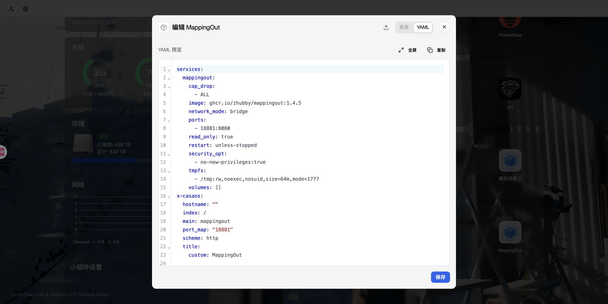
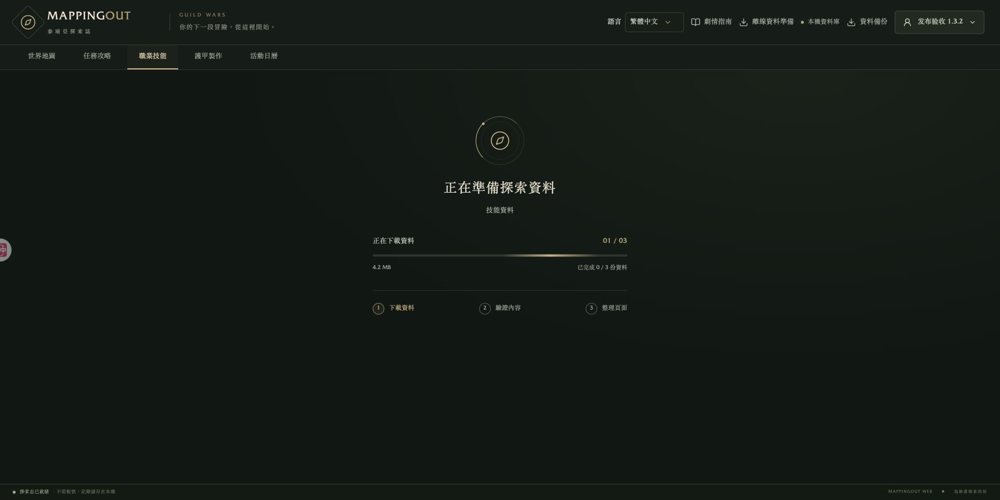
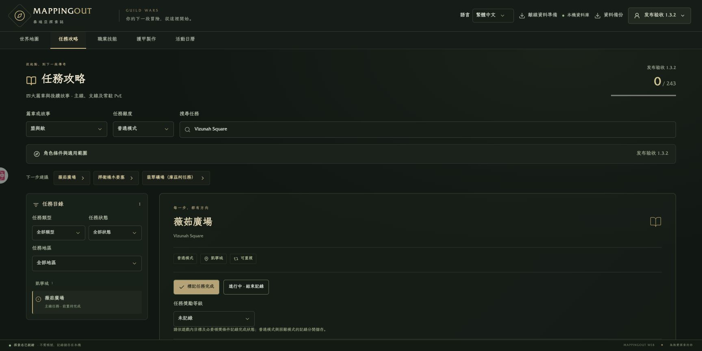

# 1.4.5 发布验收

日期：2026-11-23。
发布目标：desktop-v1.4.5。
发布源码：`26fc3302c0d59519ebb199157399d3df82b2398a`。
本版为阶段性交付，全文逐句校对未完成。

## 本地验证与来源覆盖

本轮净新增 361 个精确字段绑定。
五套资料实际修订 375 个繁体字段。
累计代理审读覆盖 9,657 个字段位置。
仍有 124,472 个字段位置未逐句审读。
全部改文均落在有效校对绑定内。
英文源文实际修复 81 个字段。
其中护甲 78 个、任务 1 个、技能模板 2 个。
详见 [全文校对记录](full-text-proofreading.md)。

生产构建通过。
合并 main 后，24 个文件的 353 项单元测试通过。
正式发布门禁完整性错误为零。
103 个技能版本通过 1,236 次真实组件呈现。
1,800 次数值与 36 次重复词元检查通过。
覆盖属性 0、12、15 与称号最低、最高边界。
Ether Lord 与 Life Siphon 的三个词元独立。
衰减为负值，再生为正值，繁英结果一致。
本轮未在游戏内或桌面安装包中核验这些正文。

当前 6,897 个来源引用采用组合覆盖。
原 6,895 个引用与同日完整检查逐项一致。
原检查时间为 04:23:21 UTC。
新增两个 Collector 子页在 06:48:40 UTC 回读。
两页固定修订与在线当前修订一致。
新增、移除和变更引用均按原算法复算。
没有移除引用，也没有修改原引用。
后续完整重查在 1,050 进度后遇到 HTTP 403。
失败检查不计入成功覆盖。
报告保留两段时间，不声称重新全量检查成功。
证据：`data/i18n/wiki-revision-increment-2026-11-23.json`。

发布输入指纹：
`6a7747c0ea7bccdb80d0ab302e52f8a2fbf1d5329c9c8b6fc5f8f80d4b252209`。
例外只绑定本版、本指纹和五类已披露问题。
134,129 个繁体字段仍待人工批准。
360 项数值词元、11,462 项拉丁文字仍待审查。
2,026 个英文字段的可信来源仍待核实。
Friz 分发许可仍未批准。

## 正式流水线

[桌面正式流水线](https://github.com/zhubby/mappingout/actions/runs/45128489896)
全部通过。
Windows x86、x64、macOS arm64 签名构建全部成功。
各平台通过 353 项单元测试与 25 项原生测试。
资源签名、发布与三平台更新清单合并成功。

[main 容器流水线](https://github.com/zhubby/mappingout/actions/runs/45128450059)
与 [正式容器流水线](https://github.com/zhubby/mappingout/actions/runs/45128489831)
全部通过。
两个架构各通过 353 项单元测试与最终镜像 HTTP 验收。
amd64 最终镜像通过 28 项浏览器回归。
已验收镜像原样上传并合并双架构索引。

[1.4.5 正式版](https://github.com/zhubby/mappingout/releases/tag/desktop-v1.4.5)
于 2026-11-23 07:20:07 UTC 公开。

## 公开产物回读

10 个公开文件的大小与 GitHub SHA-256 一致。
安装包和更新包符合 SHA256SUMS.txt。
三平台更新签名与可信版本注释通过。
公开 latest 端点与本版 latest.json 一致。
程序更新公钥保持原值。

资源清单与资源频道通过独立公钥验签。
三个 ZIP 的哈希全部一致。
ZIP 内 3,713 个文件逐个通过大小与哈希检查。
资源代次为：
`430f0f3f3721074864e38f554651a2789799c358003659caf4b8dcfc604f95fb`。

| 资源包 | 文件数 | SHA-256 |
| --- | ---: | --- |
| media | 3,683 | `94ef222a5fe49e234c955ad9196ab397bfec4f7668ca4b4e0ccd13193f962249` |
| data | 22 | `a684cd2433b2a0bfcd397523dbd974bad2794f0dc0c27365cb23d3edd80de349` |
| fonts | 8 | `1a18e395a4ba6a6b939d992d896fa7067f9c82edadfc19389743678890c381ee` |

匿名 GHCR 1.4.5 与 latest 指向同一双架构索引。
版本和源码标注与发布标签一致。
索引摘要为：
`sha256:1c23fff6679a51b9a91b490e41573c2843192bd22c655e8c895f759ee50326ed`。

| 架构 | 清单摘要 | 镜像配置摘要 |
| --- | --- | --- |
| amd64 | `sha256:1e35290517807d26cbe8be13ca7c326f47cb3000f276f128cf248acf84f22ce1` | `sha256:c17450545f9c3dda83111c39b93eb6c5e40f1db7ff4e6bc0a3f4908302362ed6` |
| arm64 | `sha256:51d5da9e85411b0cde3a0ba0a88999a921550d92ba6ca78272c66e674eea4c8b` | `sha256:bbfe9750ce0b153e41922aed6cef597cee65ddb7ce34578b365f5e14a7288df2` |

完整公开回读与 CI 日志证据位于忽略目录：
`releases/verification-1.4.5/`。

## ZimaBoard2 实机部署

沿用 ZimaOS → MappingOut → 管理 → YAML。
原镜像为 `ghcr.io/zhubby/mappingout:1.4.4`。
原端口为 `18881:8080`，未配置持久化卷。
更新前 YAML 保存在忽略目录：
`releases/verification-1.4.5/zima-before.yaml`，权限 600。
镜像已更新为 `ghcr.io/zhubby/mappingout:1.4.5`。
保存后重新打开配置，回读版本和全部参数。
bridge、只读文件系统、tmpfs 与安全选项保持原值。
回滚时从原入口恢复 YAML 或将镜像改回 1.4.4。
个人记录继续保存在原 origin 的 IndexedDB。

容器切换期间，旧服务仍响应请求。
此时首轮字节比较发现旧版 catalog 并失败。
等待 ZimaOS 完成替换后，按原断言重新比较。
8 项文件逐字节比较与 SHA-256 全部通过。
覆盖 HTML、入口 JS、CSS 与五套繁体资料。
证据为 `zima-http-hashes.json`。

- 入口：[MappingOut](http://192.168.11.35:18881/)。
- Dozzle 主机为 ZimaBoard2，新容器为 `b6640c44df20`。
- 实际镜像为 1.4.5，容器健康标识为 healthy。
- 当前容器访问日志中的页面与资料请求返回 200。
- Ether Lord 属性 12 显示持续 9 秒、衰减 -3、再生 +3。
- Life Siphon 属性 12 显示持续 22 秒、衰减 -3、再生 +3。
- 两条技能切换英文原文后，数值和正负号一致。
- 角色「发布验收 1.3.2」保留。
- 薇茹廣場的「進行中 · 結束記錄」保留。

切换后的 HTTP 全量检查首次遇到下载超时。
同时间段浏览器正在下载完整字体和资料。
随后独立读取 catalog 为 200，耗时 7.741 秒。
健康端点为 200，耗时 0.085 秒。
保留失败日志，再按原脚本和 15 秒超时重新运行。
第二次 HTTP 全量检查通过，没有修改验收断言。
覆盖健康探针、资料、字体、MIME 与缓存策略。
gzip、条件请求、Range 与真实 404 均通过。
成功日志为 `zima-http-smoke.log`。
首次超时日志为 `zima-http-smoke-initial-timeout.log`。

局域网 HTTP 支持在线使用；完整 Web 离线缓存需要 HTTPS。

[PROTOCOL]: Update this header on change, then check AGENTS.md
