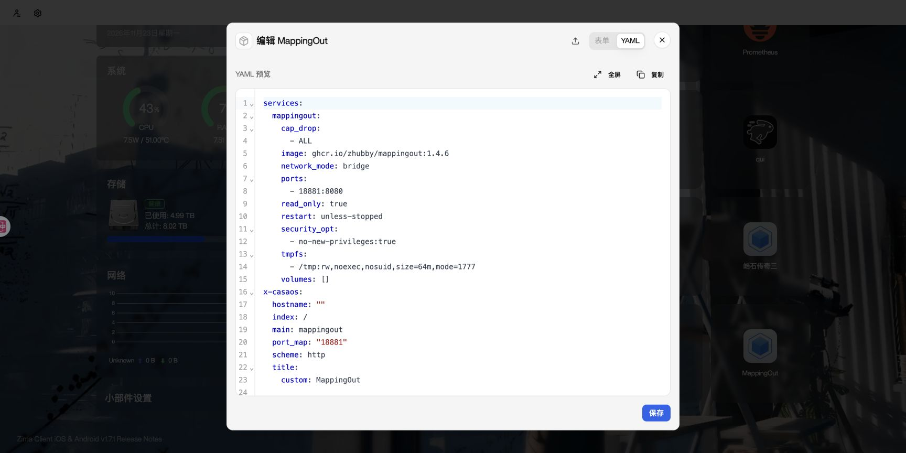
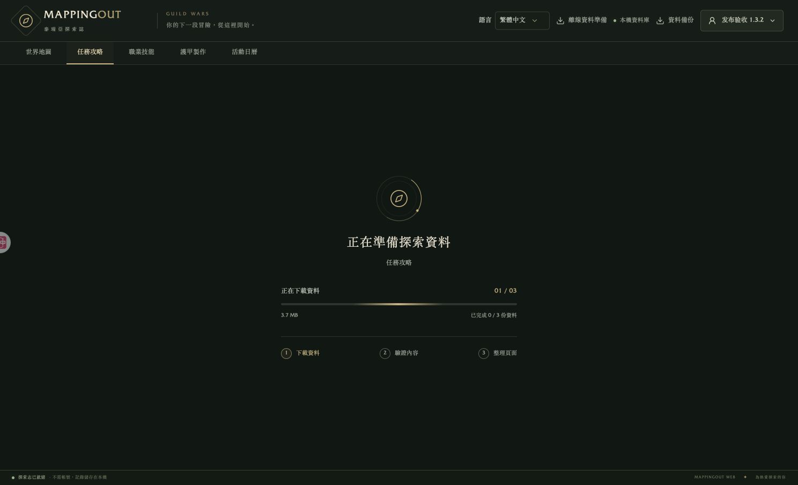
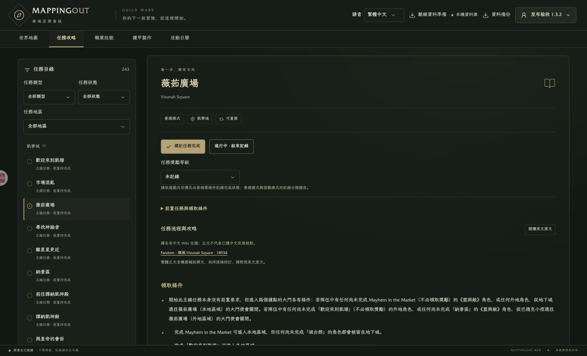

# 1.4.6 发布验收

日期：2026-11-23。
发布标签：desktop-v1.4.6。
发布源码：`357fdc0bab88386ed2b53cc6c8d937bcc318fcee`。
本版为阶段性交付，全文逐句校对未完成。

## 校对与本地验证

本轮 450 条记录新增 689 个精确字段绑定。
实际修订 386 个繁体字段。
护甲 197 个、地图标签 31 个、任务 117 个、技能 41 个。
全部改文均落在本轮有效绑定内。
英文正文、基线、数值表与来源修订保持原值。
累计代理审读 10,346 个字段位置。
仍有 123,783 个字段位置未逐句审读。
代理审读不代表人工批准或游戏内核验。
详见 [全文校对记录](full-text-proofreading.md)。

生产构建通过。
合并 main 后，24 个文件的 353 项单元测试通过。
生产 Web 浏览器回归 60 项通过。
最后一处桥梁措辞收紧后重新构建。
最终生产构建的任务浏览器回归 12 项通过。
发布门禁完整性错误为零。

发布输入指纹：
`17bb30f51e6bd7c4e8c485aafa12c9d9dd2405d9ba85770aeef12b98ae0a6dd0`。
例外只绑定本版、本指纹和五类既有问题。
134,129 个繁体字段仍待人工批准。
363 项数值词元、11,625 项拉丁文字仍待审查。
2,026 个英文字段的可信来源仍待核实。
Friz 分发许可仍未批准。

本版没有改变 6,897 个英文引用。
沿用同日完整检查和两个新增引用的独立回读。
原完整检查时间为 04:23:21 UTC。
两个新增引用的回读时间为 06:48:40 UTC。
此处不声称本版重新全量检查在线 Wiki。
来源证据见 `data/i18n/wiki-revision-increment-2026-11-23.json`。

## 正式流水线与公开产物

[桌面正式流水线](https://github.com/zhubby/mappingout/actions/runs/45137603772)
全部通过。
Windows x86、x64、macOS arm64 签名构建成功。
各平台通过 353 项单元测试与 25 项原生测试。
三平台更新清单和资源签名发布成功。

[main 容器流水线](https://github.com/zhubby/mappingout/actions/runs/45137568809)
与 [正式容器流水线](https://github.com/zhubby/mappingout/actions/runs/45137603830)
全部通过。
两个架构各通过 353 项单元测试与最终镜像 HTTP 验收。
amd64 最终镜像各通过 28 项浏览器回归。
已验收镜像原样上传并合并双架构索引。

[1.4.6 正式版](https://github.com/zhubby/mappingout/releases/tag/desktop-v1.4.6)
于 2026-11-23 08:33:20 UTC 公开。
10 个公开文件大小与 GitHub SHA-256 一致。
安装包和更新包符合 SHA256SUMS.txt。
三平台更新签名与可信版本注释通过。
公开 latest 端点与本版 latest.json 一致。
程序更新公钥保持原值。

资源清单与资源频道通过独立公钥验签。
三个 ZIP 的哈希全部一致。
ZIP 内 3,713 个文件逐个通过大小与哈希检查。
资源代次为：
`4443b80a983d4c31c09a05ab20845555582dd59c43a82f27abc92169aed1acfb`。

| 资源包 | 文件数 | SHA-256 |
| --- | ---: | --- |
| media | 3,683 | `94ef222a5fe49e234c955ad9196ab397bfec4f7668ca4b4e0ccd13193f962249` |
| data | 22 | `cca8b1027c8862f00dd42963b8175e55aa68ca843b08a8cbf6b12d287390888b` |
| fonts | 8 | `1a18e395a4ba6a6b939d992d896fa7067f9c82edadfc19389743678890c381ee` |

匿名 GHCR 1.4.6 与 latest 指向同一双架构索引。
版本和源码标注与发布标签一致。
索引摘要为：
`sha256:1c3fb0803c6fc25d29d5cc7d2c1814f4998026453319a615115e6136e3a3b622`。

| 架构 | 清单摘要 | 镜像配置摘要 |
| --- | --- | --- |
| amd64 | `sha256:2ca298ecf65e4ab683c0158fdbfc283ed0076c1a7df40ce459502c4197a8a69b` | `sha256:4d581de7cb7ad535a3f57108c7427db99207b537a83aab36bff184c5748ba236` |
| arm64 | `sha256:0f61c6e8c491bbf60d45d68021dd4a6887d85e92bec4d334d877169b97752c4c` | `sha256:7bdc044f365737d298cf7053dbd463c5134eb2bc3822b764d43408712188c397` |

## ZimaBoard2 部署

沿用 ZimaOS → MappingOut → 管理。
原镜像为 `ghcr.io/zhubby/mappingout:1.4.5`。
更新后为 `ghcr.io/zhubby/mappingout:1.4.6`。
表单只修改 Tag，保存前核对完整 YAML。
保存后重新打开 YAML，回读版本和全部参数。
端口仍为 `18881:8080`，没有持久化卷。
bridge、只读文件系统、tmpfs 与安全选项保持原值。
回滚时从原入口将镜像改回 1.4.5。

原 YAML 和更新前个人备份保存在忽略目录。
两个文件的本地权限均为 600。
备份通过应用自身的 v3 解析器校验。
包含 1 个角色、1 条任务进度，0 条笔记。
个人记录继续保存在原 origin 的 IndexedDB。

入口：[MappingOut](http://192.168.11.35:18881/)。
Dozzle 主机为 ZimaBoard2。
新容器为 `35f464d2af87`，实际镜像为 1.4.6。
可见状态图标的 data-status 为 healthy。
当前容器访问日志中的页面与资料请求返回 200。
8 项文件逐字节比较与 SHA-256 全部通过。
覆盖 HTML、入口 JS、CSS 与五套繁体资料。
HTTP 全量验收通过。
覆盖健康探针、资料、字体、MIME 与缓存策略。
gzip、条件请求、Range 与真实 404 均通过。

页面刷新后，原角色「发布验收 1.3.2」保留。
薇茹廣場的「進行中 · 結束記錄」保留。
护甲搜索 Simple Mask 显示 Ranger Simple Mask。
没有继续显示旧的面膜误译。
任务加载页显示真实 3.7 MB 下载量与三阶段进度。

技能抽查仍见 Lava Font 的既有动态长正文误译。
该正文仍有「陰暗」及相邻／附近范围问题。
本批审读其短文，没有重审该动态长正文。
此项保留为后续缺口，不计本版已修复。

完整公开回读、CI 日志与实机证据位于忽略目录：
`releases/verification-1.4.6/`。
局域网 HTTP 支持在线使用；完整 Web 离线缓存需要 HTTPS。
本轮没有在桌面安装包或游戏内核验所有校对正文。

[PROTOCOL]: Update this header on change, then check AGENTS.md
