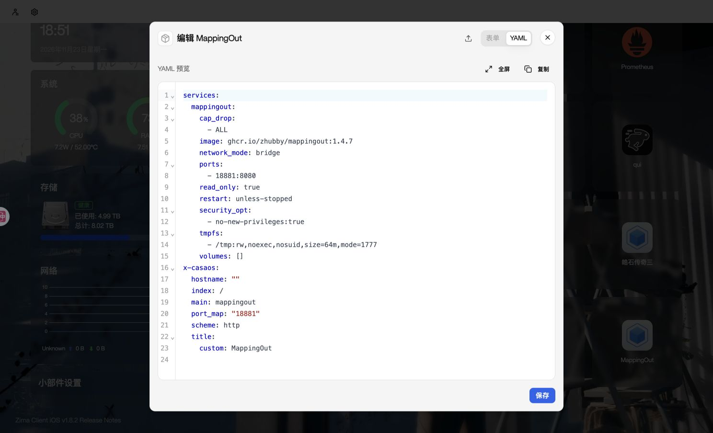
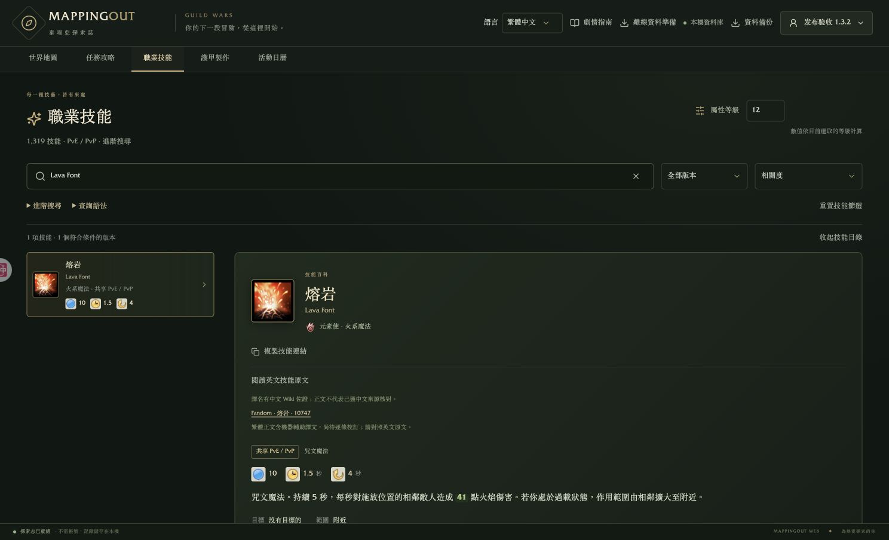
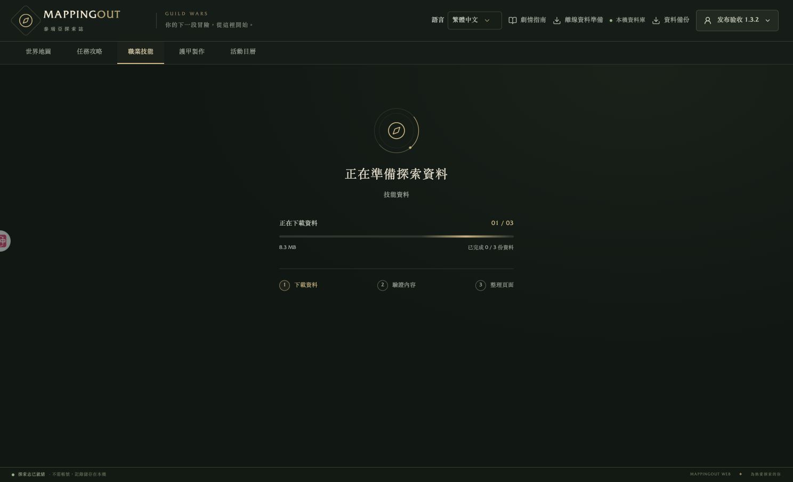
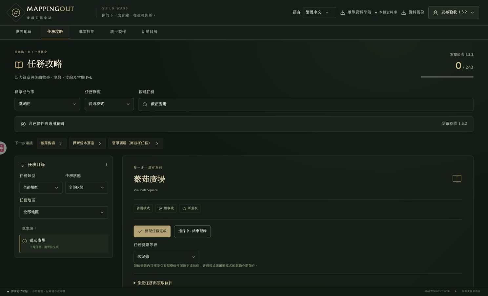

# 1.4.7 发布验收

日期：2026-11-23。
发布标签：desktop-v1.4.7。
发布源码：`74fd6c63dfc871f8bf23da62356c5b9d682ebda9`。
用户明确要求合并 main、提交推送、发布并部署 ZimaBoard。
本版为第五批阶段性交付，全文逐句校对未完成。

## 校对与本地验证

本轮 667 条记录新增 1,411 个精确字段绑定。
实际修订 1,331 个繁体字段。
护甲 692 个、任务 155 个、技能 484 个。
其余 80 个绑定在审读后保留原文。
全部改文均落在本轮有效绑定内。
英文、基线、原始资料、数值表与来源修订保持原值。
累计代理审读 11,757 个字段位置。
仍有 122,372 个字段位置未逐句审读。
代理审读不代表人工批准或游戏内核验。
详见 [全文校对记录](full-text-proofreading.md)。

353 项单元测试和 60 项生产 Web 回归通过。
1.4.7 生产构建与正式门禁通过。
148 个技能版本共 1,776 次真实组件呈现通过。
3,228 处数值与 84 次重复词元检查无错误。
覆盖属性 0、12、15，称号最低／最高与繁英。
结果绑定最终资料的 SHA-256。

发布输入指纹：
`23878795bc8476e20de80bc13d7666ef83d32d0f8c3c7addcdffca56c5727e19`。
例外只绑定本版、本指纹和五类既有问题。
134,129 个繁体字段仍待人工批准。
372 项数值词元、11,937 项拉丁文字仍待审查。
2,026 个英文字段的可信来源仍待核实。
Friz 分发许可仍未批准。
技能备注的 54 种英文、56 个字段仍残留原始标记。
该来源审计状态为尚未修复，不计为本版修复。
Winter 的精灵适用范围仍标为来源冲突待核实。

本版没有改变 6,897 个英文引用。
沿用同日完整检查和两个新增引用的独立回读。
原完整检查时间为 04:23:21 UTC。
两个新增引用的回读时间为 06:48:40 UTC。
本版没有重新全量检查在线 Wiki。
来源证据见 `data/i18n/wiki-revision-increment-2026-11-23.json`。

## 正式流水线

[桌面正式流水线](https://github.com/zhubby/mappingout/actions/runs/45157578746)
全部通过。
Windows x86、x64、macOS arm64 签名构建成功。
各平台通过 353 项单元测试与 25 项原生测试。
三平台更新清单和资源签名发布成功。

[main 容器流水线](https://github.com/zhubby/mappingout/actions/runs/45157573765)
与 [正式容器流水线](https://github.com/zhubby/mappingout/actions/runs/45157578865)
全部通过。
两个架构各通过 353 项单元测试与最终镜像 HTTP 验收。
amd64 最终镜像各通过 28 项浏览器回归。
已验收镜像原样上传并合并双架构索引。

[1.4.7 正式版](https://github.com/zhubby/mappingout/releases/tag/desktop-v1.4.7)
于 2026-11-23 10:52:15 UTC 公开。

## 公开产物回读

10 个公开文件大小与 GitHub SHA-256 一致。
安装包和更新包符合 SHA256SUMS.txt。
三平台更新签名与可信版本注释通过。
公开 latest 端点与本版 latest.json 一致。
程序更新公钥保持原值。

资源清单与资源频道通过独立公钥验签。
三个 ZIP 的哈希全部一致。
ZIP 内 3,713 个文件逐个通过大小与哈希检查。
资源代次为：
`a734186764cf5b07d2e1419dd674935c714a2c76b3b83b9385eff6502303f131`。

| 资源包 | 文件数 | SHA-256 |
| --- | ---: | --- |
| media | 3,683 | `94ef222a5fe49e234c955ad9196ab397bfec4f7668ca4b4e0ccd13193f962249` |
| data | 22 | `4befe433c9ec185dc50f35ef67d68a3c935a6413d7267a66226f048fd1ffa7ca` |
| fonts | 8 | `1a18e395a4ba6a6b939d992d896fa7067f9c82edadfc19389743678890c381ee` |

匿名 GHCR 1.4.7 与 latest 指向同一双架构索引。
版本和源码标注与发布标签一致。
索引摘要为：
`sha256:7091e1025416151b04c75573ba6652a4f3708eef3890ae6aefa53ad27e69a7d0`。

| 架构 | 清单摘要 | 镜像配置摘要 |
| --- | --- | --- |
| amd64 | `sha256:08e236bca93f93f6a653e2104a5b5d2ae8e3ff0467dd0e177956696db2534f29` | `sha256:12d688223206c8294f305da93c19cdf9d43cdf1b108b5afab7e0601f85628557` |
| arm64 | `sha256:7dad255f2c14edba9ae8724d88290fef1182a03caa0cb48ccc52805507d9e761` | `sha256:e117eb6bd2c3482fb7a2ed3e15bcfedc84a2bc7833445a85e7bbfa776744783c` |

## ZimaBoard2 部署

沿用 ZimaOS → MappingOut → 管理。
原镜像为 `ghcr.io/zhubby/mappingout:1.4.6`。
更新后为 `ghcr.io/zhubby/mappingout:1.4.7`。
表单只修改 Tag，保存前核对完整 YAML。
保存后重新打开 YAML，回读版本和全部参数。
回读结果与原 YAML 的差异只有镜像版本。
端口仍为 `18881:8080`，没有持久化卷。
bridge、只读文件系统、tmpfs 与安全选项保持原值。
回滚时从原入口将镜像改回 1.4.6。

原 YAML、更新后 YAML 和个人备份保存于忽略目录。
YAML 和个人备份的本地权限均为 600。
备份通过应用自身的 v3 解析器校验。
包含 1 个角色、1 条任务进度，0 条笔记。
个人记录继续保存在原 origin 的 IndexedDB。

入口：[MappingOut](http://192.168.11.35:18881/)。
Dozzle 主机为 ZimaBoard2。
新容器为 `c4a715a0fad4`，实际镜像为 1.4.7。
当前容器的可见健康状态为 healthy。
访问日志中的页面与资料请求返回 200。
8 项文件逐字节比较与 SHA-256 全部通过。
覆盖 HTML、入口 JS、CSS 与五套繁体资料。
HTTP 全量验收通过。
覆盖健康探针、资料、字体、MIME 与缓存策略。
gzip、条件请求、Range 与真实 404 均通过。
重建期间首次 HTTP 验收遇到短暂拒绝连接。
容器就绪后重新执行并完整通过。
失败日志单独保留，不计为通过。

刷新后，原角色「发布验收 1.3.2」保留。
薇茹廣場的「進行中 · 結束記錄」保留。
Lava Font 显示属性 12 的 41 点火焰伤害。
说明明确过载将相邻范围扩大至附近。
伤害区域固定在施放位置。
Predatory Season 明确范围内每个攻击者各获体力。
加载页显示真实下载字节量与三阶段进度。

完整 CI 日志、公开回读和实机证据位于忽略目录：
`releases/verification-1.4.7/`。
局域网 HTTP 支持在线使用；完整 Web 离线缓存需要 HTTPS。
本轮没有在桌面安装包或游戏内核验所有校对正文。

[PROTOCOL]: Update this header on change, then check AGENTS.md
