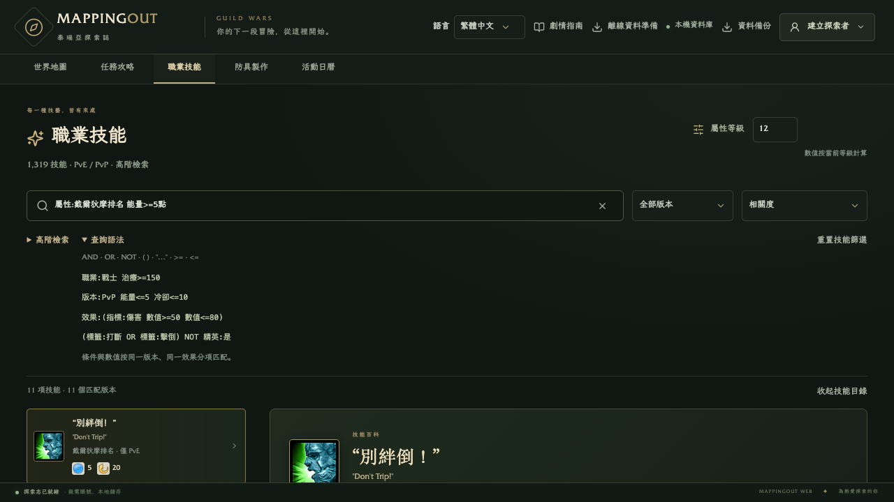

# 繁體中文遷移驗收

日期：2026-11-19。分支：`codex/traditional-chinese`。
最初完成本地遷移。使用者後續授權全部修復、發布與 ZimaBoard 部署。

## 實作範圍

- 預設語言為 `zh-TW`，另一語言為 English。
- 舊 `zh-CN`、缺失及無效偏好遷移為 `zh-TW`。
- 網頁、桌面前端、原生對話框及五套資料使用繁體。
- 舊名稱、名稱的繁體形式及舊分享連結保留。
- 查詢接受簡繁英欄位、職業、篇章及屬性。
- Web 已訪問快取及完整離線清單改用繁英路徑。
- 桌面驗簽仍能讀取舊包，本版不以舊中文包啟動。
- 舊包快取進入資源準備，匯入完整繁英包後恢復。

五套原始資料、英文包及英文基線保持一致。
ID、座標、技能數值、配方、輪換與備份 v3 不變。
應用身份、公鑰與頻道不變。發布版本為 1.4.0。
新資源相容範圍為 `>=1.4.0, <2.0.0`。

## 中文證據與翻譯邊界

固定 Fandom 正文與模板共 6,669 頁。
灰機摘錄包含 42 筆可見的戰士精英表格譯名。
灰機摘錄綁定修訂 40248，記錄表格轉錄方式。
灰機 API 返回 403，未將摘錄冒充原始 wikitext。

術語表包含 5,263 筆英文身份及 77 組歧義。
Fandom 譯名優先；同等證據的衝突不自動採用。
採用「極地之眼」「神喚使」「暗殺者」「弓術精通」「祕法」。
術語佐證只代表譯名，不代表正文經中文來源核對。

缺少中文佐證的內容從固定英文重新翻譯。
42,785 段不同英文均有繁體稿，最終使用線上重譯。
本地模型壞稿已替換，未把未知詞元加入成品。
機器稿、編輯用詞及既有技能語義修正分開記錄。
所有繁體欄位保留待審，未繼承舊簡體批准。
旅者交換數量與技能資源列由既有事實直接呈現。
6 處舊英文缺字保持原文，繁體標為「原始資料缺字」。
這 6 處仍屬英文來源缺口，不算已核實內容。

## 自動驗證

全部命令使用 Node.js 24.11.1。聯網翻譯經本機 7890 代理。
下表記錄最初遷移驗證，審查修復後的結果在後文追加。

| 檢查 | 結果 |
| --- | --- |
| `npm run i18n:compile:ui` | 繁體界面與查詢別名產生成功 |
| `npm run i18n:compile` | 133,802 個繁體欄位完成投影 |
| `npm run validate:i18n` | 267,604 個繁英欄位，0 完整性錯誤 |
| `npm test` | 313 項通過 |
| `cargo test --manifest-path desktop/Cargo.toml` | 24 項通過，包含新簽名包及舊包恢復 |
| `cargo fmt --manifest-path desktop/Cargo.toml --check` | 通過 |
| `npm run desktop:frontend:build` | 通過，產生三類獨立資源包 |
| `npm run test:e2e:updates` | 11 項通過 |
| `npm run build` | Web 生產建置通過 |
| `npm run test:e2e` | 54 項通過 |

字型檢查覆蓋繁體文案的 3,010 個漢字，缺字為 0。
已檢視桌面及 390px 手機截圖。
手機截圖等待語言投影及地圖載入後保存。
截圖回歸另行重跑 1 項通過。
Web 完整離線清單只有五套 `zh-TW` 及 `en` 包。
原生簽名包包含五套原始資料及全部繁英包。
原始資料、英文包、英文基線和審校紀錄的 Git 差異為空。

最初遷移的本地簽名資源 generation：
`99e6622ba8e8db4b93644c8c9cdc969a024b547f174ada7398e59216ecdb6761`。

桌面更新測試使用專案命令產生未拆包前端。
IPC 替身不提供原生資源協定，不能直接測已拆包目錄。
已拆包資源由原生簽名、雜湊及相容性測試驗證。

## 保留的審校項目

| 自動統計 | 數量 |
| --- | ---: |
| 待逐欄位審校 | 133,802 |
| 數值或順序待查 | 373 |
| 含未列為允許詞的拉丁文字 | 11,214 |
| 英文待來源核實 | 2,026 |
| 舊英文缺字欄位 | 6 |

數值待查包含 264 項順序與 109 項數量或單位。
這是機器比對結果，不是已判定的語義錯誤清單。
嚴格檢查仍列出待審譯文及未確認的 Friz 分發授權。
使用者授權發布後，重新評估五類可例外項目。
本版例外只綁定 1.4.0 與新輸入指紋：
`6b92b4f229b71f697f0d8d7c32efff8044c442326819fcaae4301f0a5ea85561`。
完整性、固定來源和雜湊錯誤仍阻止發布。

## 審查修復

- Wiki 名稱抽取清除換行標記，排除媒體與分類命名空間。
- 重建 295 段受污染稿件；五套資料均無 ` ` 或媒體名稱污染。
- 屬性別名從完成的資料包產生，支援實際顯示的稱號名稱。
- 數值查詢接受 `點`，提示與四組範例透過語言字典顯示。
- 新增抽取、真實資料查詢、單位與瀏覽器回歸。
- 資源相容範圍排除 1.2.0 至 1.3.2，保留頻道中的舊資源。

| 修復後檢查 | 結果 |
| --- | --- |
| 針對性回歸 | 34 項通過 |
| 全量單元測試 | 322 項通過 |
| Rust 與格式檢查 | 25 項通過，格式通過 |
| 桌面更新前端回歸 | 11 項通過 |
| Web 瀏覽器回歸 | 54 項通過，新增查詢測試修正預期後單獨重跑通過；共 55 項 |
| Web 與桌面前端生產建置 | 通過 |
| 繁英完整性與正式發布門禁 | 通過；五類待審項按本版例外記錄 |

本版簽名資源 generation：
`0ede4b4281935491bdf3e6171177aaa8334df499c9343b3481d48e022d9bc57c`。
三包大小分別為 78,902,978、10,086,509、14,461,386 bytes。
簽名使用原資源公鑰驗證，清單限制 1.4.0 以上客戶端。
屬性查詢回傳 14 項，能量至少 5 點時回傳 11 項。
另 3 項消耗怒氣且能量為 0，依原始資料核實。

發布結果在完成後追加。

## 平台與發布限制

瀏覽器驗證使用本機 Edge / Chromium。
桌面前端建置及 Rust 測試不等同安裝包實機驗收。
本次未做三平台安裝、原生視窗操作或正式更新。

舊客戶端不會自動取得新的繁體完整性檢查。
新資源已分隔舊客戶端相容範圍，原生回歸驗證此條件。
既有翻譯待審、數值待查及字體授權門禁保持有效。
本版例外已按新的發布授權重新評估，未授予人工審校或字體授權。

[PROTOCOL]: Update this header on change, then check AGENTS.md
